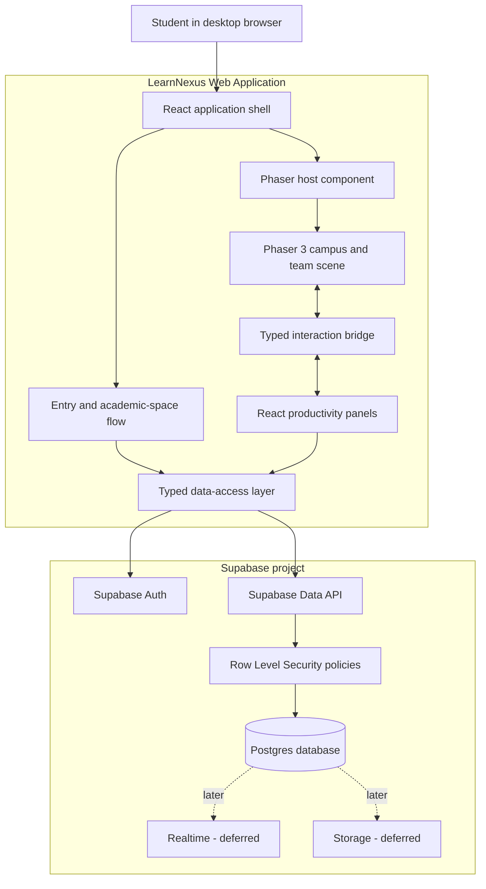
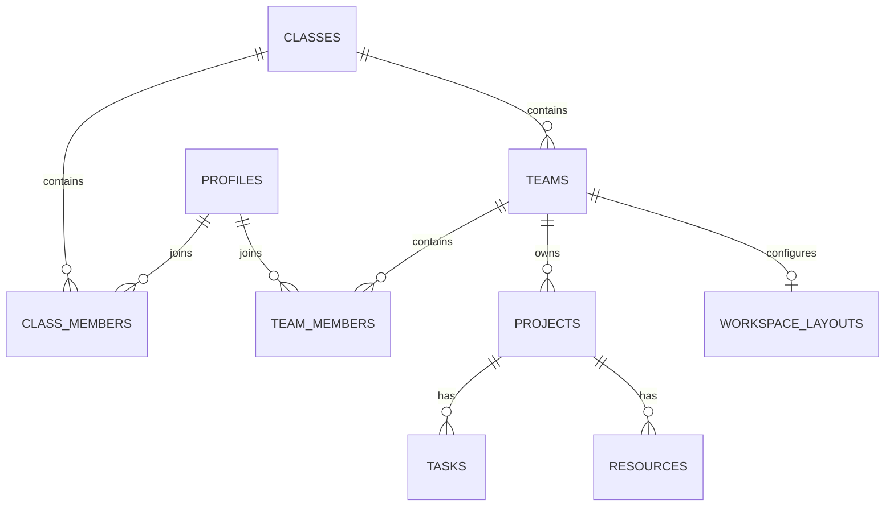

> **Status:** Approved architecture specification & technical direction update  
> **Version:** 0.3  
> **Last updated:** 24 November 2026  
> **Related:** `PRD.md`, `DESIGN.md`, `MILESTONE.md`  
> **Repository audited:** [edgiaxel/LearnNexus](https://github.com/edgiaxel/LearnNexus)  
> **Delivery target:** STACK 2026 Semifinal — 30 November 2026, 23:59 WIB

---

## 1. Read This First

- **Architecture in one paragraph:** LearnNexus is a persistent virtual learning environment that connects academic spaces with collaborative project workspaces. The browser application is built with React 19 and TypeScript for application chrome, navigation, academic course interfaces, and accessible workstation productivity panels; Phaser 3 provides an isolated, crisp 2D pixel-art spatial campus environment. Supabase Postgres with Row Level Security (RLS) provides durable asynchronous persistence for project overviews, task sprint boards, and resource libraries, ensuring students can work independently when teammates are offline. The semifinal build delivers one complete student workflow before introducing multiplayer presence or lecturer administration.
- **Selected stack:** React 19 + TypeScript + Vite; Phaser 3 (retained; PixiJS deferred); Supabase Postgres with `@supabase/supabase-js` v2 and RLS; Tailwind CSS implementing Cozy Digital Campus design tokens (`DESIGN.md`); Playwright for browser end-to-end testing.
- **Main components:** React application shell; Phaser 2D environment; typed interaction bridge (`eventBridge.ts`); typed data-access layer (`academicService.ts`); Supabase Auth / Demo Mode; Supabase Postgres with RLS.
- **Current technical risk:** Ensuring crisp, sharp canvas rendering for 2D pixel-art assets without blur; maintaining strict isolation between React UI and Phaser scene lifecycle; completing durable persistence for the M3 milestone.
- **Current implementation status:** M0, M1, and M2 completed and verified with Playwright tests on `localhost` (single-mount Phaser canvas, workstation event bridge, live demo entry, and initial Supabase schema). M2.5 design alignment documented; M3 persistence in progress.
- **Next technical action:** Execute M3 persistence and apply the Phaser canvas rendering configuration audit (ADR-012) to ensure sharp pixel-art display and Cozy Digital Campus visual consistency.

### Evidence and confidence labels

- **Verified:** Directly observed in the repository code, package manifest, or passing test suite.
- **Documented:** Defined in the approved PRD, DESIGN, or ARCHITECTURE specification.
- **Approved:** Technical decision formally approved by the team.
- **Deferred:** Intentionally delayed to future milestones to protect semifinal delivery.

## 2. Repository and Implementation Status

### 2.1 Current repository state

| Item | Status | Evidence |
|---|---|---|
| Application source | Implemented | React 19 + TypeScript + Vite + Tailwind CSS + Phaser 3 in `src/` |
| Package manifest | Pinned | `package.json` and `package-lock.json` committed |
| 2D Game Lifecycle | Implemented | `PhaserHost.tsx`, `createGame.ts`, `CampusScene.ts` |
| Interaction Bridge | Implemented | `eventBridge.ts` with typed workstation and panel events |
| Database & Schema | Connected | Live Supabase project (`zftymjkcrdkhtshazzmw`) in `ap-southeast-1` with M2 schema & seed data |
| Automated Tests | Passing | 9-test Playwright E2E suite (`tests/e2e/entry-flow.spec.ts`) |
| Visual Prototype | Active Alignment | Aligning UI to Cozy Digital Campus (`#F7F4EC` warm cream, soft sage, muted green, lavender) |

### 2.2 Technical constraints

1. **No Unapproved Engine Swaps:** Retain Phaser 3. Do not migrate to PixiJS or introduce a second rendering engine.
2. **Strict Rendering Separation:** Phaser owns spatial scene rendering; React owns all productivity panels, forms, and navigation.
3. **No Unapproved Backend Migrations:** Retain Supabase Postgres with RLS; do not introduce a custom backend server.
4. **Preserve Valid Progress:** Build incrementally upon verified M1/M2 code without destructive rewrites.

## 3. Technology Stack

| Layer | Technology/version | Purpose | Status/reason |
|---|---|---|---|
| Language | TypeScript | Shared typed contracts across UI, game, and data access layers | Approved |
| UI framework | React 19 | Application shell, academic directory, productivity panels, forms | Approved |
| Build tool | Vite 8 | Fast local development and optimized production bundling | Approved |
| Runtime | Node.js 24.22.1 (20.19+ compatible) | Development and build runtime | Verified |
| Package manager | npm 9.2.0+ | Dependency installation and lockfile management | Verified |
| 2D environment | Phaser 3 (v3.88.2) | 2D campus navigation, tilemaps, sprite animation, camera follow, and collision handling | Approved (Retained; PixiJS deferred) |
| Styling | Tailwind CSS implementing Cozy Digital Campus tokens | Warm cream background (`#F7F4EC`), white surfaces, soft sage, lavender, charcoal text | Approved |
| Client state | React state/context | Session, selected class/team, open drawer panel, transient UI state | Approved |
| Backend/database | Supabase Postgres | Persistent academic spaces, teams, projects, tasks, and resource records | Approved |
| Client SDK | `@supabase/supabase-js` v2 | Typed database queries and auth operations from the browser | Approved |
| Authentication | Dual-mode: Demo Profiles + Supabase Auth | Transparent demonstration access with production auth readiness | Approved |
| Authorization | Postgres Row Level Security (RLS) | Enforce class and team boundary access at database level | Approved |
| Realtime | Supabase Realtime | Later presence or live project updates | Deferred |
| File storage | Supabase Storage | Later resource uploads and deliverable files | Deferred (P0 uses verified URLs) |
| E2E testing | Playwright | End-to-end browser verification of the complete student journey | Verified (passing) |
| AI | None | AI features are not required for the current product scope | Explicitly out of scope |

### 3.1 Why this architecture

- A separate custom backend API would add work without a demonstrated need for custom server behavior in the P0 scope.
- Supabase provides Postgres, Auth, Storage and Realtime as separate building blocks. The team can start with Postgres and add Auth or Realtime only when the workflow requires them.
- React and Phaser have distinct responsibilities: React handles conventional application UI; Phaser handles spatial rendering and movement.
- Persistent project data must not live only inside a running Phaser scene or browser memory.
- Realtime multiplayer is intentionally delayed until a working single-user experience and persistent data path are proven.

### 3.2 Consequential decision comparison

| Decision | Recommended choice | Why | Trade-off | Status |
|---|---|---|---|---|
| Frontend foundation | React + TypeScript + Vite | Matches intended direction and supports a focused browser MVP | Team must establish project conventions from scratch | Recommended |
| 2D rendering | Phaser 3 (retained; PixiJS deferred) | LearnNexus requires character navigation, camera movement, interactive objects, tilemaps, animations, and collision handling out-of-the-box. PixiJS is a lightweight renderer but lacks tilemap/physics abstractions. PixiJS may remain a future alternative if technical evaluation demonstrates meaningful advantage, but no second engine will be introduced now. | React/Phaser lifecycle boundary must be handled carefully | Approved |
| Backend | Supabase instead of a custom API server | Managed Postgres and optional Auth/Realtime/Storage reduce backend implementation work | Vendor/platform dependency; quotas and plan limits must be checked | Recommended |
| Persistence | Supabase Postgres | Relational class/team/project/task relationships and durable records | Requires schema, migrations and RLS policies | Recommended |
| Auth for semifinal | Real Supabase Auth if it can be completed safely; otherwise a clearly labeled demo-entry mode with non-sensitive seeded data | PRD permits a sign-in/demo-entry flow; avoid building an elaborate identity system | Demo mode is not production authentication and must not be represented as secure identity | Open |
| Authorization | RLS policies tied to class/team membership | Access rules are enforced at the database boundary, not only hidden in UI | RLS policies require careful testing | Recommended |
| Realtime | Defer until core flow works | Reduces networking and synchronization risk | No live avatar presence in the first demonstrator | Recommended |
| Resource files | Seeded URLs first; Storage later | Keeps P0 focused on access and display | No upload workflow in first demo | Recommended |
| Frontend hosting | Vercel | Simple static frontend deployment for a shareable demo | Requires deployment configuration and environment variables | Recommended |
| State management | React state/context initially | Avoids premature dependency and architecture overhead | May need extraction if shared state grows | Recommended |

### 3.3 Version and platform verification

The versions above are a planning baseline, not a lockfile or claim about what is installed.

- The current Vite guide documents the React TypeScript template and a Node.js requirement of `20.19+` or `22.12+`. Use a supported Node 22 runtime and verify the actual installed version before scaffolding. See [Vite Getting Started](https://vite.dev/guide/).
- Supabase's current JavaScript installation guide documents `@supabase/supabase-js` v2. The initialization API accepts the project URL and publishable key. See [Supabase JS installation](https://supabase.com/docs/reference/javascript/installing) and [initialization](https://supabase.com/docs/reference/javascript/initializing).
- Phaser documentation exposes a v3.88.2 API reference. Pin Phaser 3 rather than silently migrating the product plan to Phaser 4. See [Phaser v3.88.2 Game API](https://docs.phaser.io/api-documentation/3.88.2/class/game).
- No paid-plan price, free quota, concurrency limit, storage limit or deployment cost is assumed here. Check the current Supabase and Vercel plan limits against the actual demo usage before relying on them.

## 4. System Architecture

### 4.1 Component diagram



### 4.2 Component responsibilities

| Component | Responsibility | Must not own |
|---|---|---|
| **React application shell** | Session-aware application frame, top navigation tabs, breadcrumbs, leave action, and global error boundary | Per-frame game movement/rendering |
| **Academic-space flow** | Show enrolled classes, select class, and route into the workspace studio | Direct SQL queries or duplicated access rules |
| **Phaser host (`PhaserHost.tsx`)** | Mount exactly one Phaser game instance, manage canvas DOM container, and handle clean unmount | Persistent project/task data |
| **Phaser scene (`CampusScene.ts`)** | Render 2D world, animate character sprites, handle movement and collision, detect workstation proximity, and emit typed events | React panel layouts, form controls, markdown editors, or direct DB access |
| **Interaction bridge (`eventBridge.ts`)** | Typed pub/sub event bus translating Phaser events into React state changes and panel actions | Business logic, permissions, or database operations |
| **Productivity panels** | Display project overview, task sprint board, and resource library; manage student edits in accessible HTML | Game canvas rendering or scene lifecycle management |
| **Data-access layer (`academicService.ts`)** | Centralize typed reads/writes to Supabase Postgres, normalize error responses | UI presentation or game state |
| **Supabase Auth / Demo Mode** | Establish user session and supply authenticated user ID for RLS evaluation | Class/team access rules by itself |
| **Postgres + RLS** | Authoritative durable storage for classes, teams, projects, tasks, and resources | Real-time avatar movement coordinates |
| **Realtime (deferred)** | Broadcast ephemeral presence and live updates across active clients | Durable project records or persistence source of truth |

### 4.3 React and Phaser boundary

LearnNexus maintains a clean, decoupled boundary between React 19 and Phaser 3:

```mermaid
flowchart LR
    subgraph ReactApp[React 19 Application]
        Shell[App Shell & Nav]
        Drawer[Productivity Drawer]
        BridgeR[Event Bridge Listener]
    end
    subgraph PhaserEngine[Phaser 3 Engine]
        Canvas[Phaser Canvas]
        Scene[Campus Scene]
        BridgeP[Event Bridge Emitter]
    end
    Shell -->|Mounts/Unmounts| Canvas
    Scene -->|Proximity Trigger [E]| BridgeP
    BridgeP -->|Typed workstation:interact| BridgeR
    BridgeR -->|Opens matching drawer| Drawer
    Drawer -->|panel:closed| BridgeP
```

1. React renders a dedicated container element (`<div data-testid="phaser-canvas-container">`).
2. A React effect mounts the Phaser game instance once via `createGame({ parent: container })`.
3. When the student approaches an interactive workstation and presses `[E]` (or clicks), the scene emits a typed `workstation:interact` event via `eventBridge.ts`.
4. React receives the event and opens the corresponding productivity panel as an accessible slide drawer.
5. While the drawer is open, keyboard input is trapped inside the HTML panel, and avatar movement is paused while keeping the 2D scene visible in the background.
6. Closing the drawer (`Escape` or `✕`) emits `panel:closed`, clearing active highlights and immediately restoring canvas keyboard focus without re-rendering or resetting the scene.
7. When navigating away from the workspace, React unmounts `PhaserHost`, cleanly destroying the Phaser game instance and unregistering all listeners.

### 4.4 Architectural boundaries

- **Strict UI and spatial engine separation:**
  - **Phaser 3 owns:** World rendering, character sprites, environmental objects, avatar movement, collision detection, camera follow, and spatial workstation proximity.
  - **React 19 owns:** Application shell, navigation, sidebars, workspace panels, forms, project-management interfaces, course information, documentation, and all conventional screens.
- **No productivity UI inside the game engine:** Phaser must never render project management forms, task sprint cards, text inputs, or complex tables directly onto the canvas. All productivity interfaces are rendered as clean, accessible HTML components managed by React.
- **Persistence boundary:** Supabase Postgres owns all durable application data. Neither Phaser transient runtime memory nor temporary browser state serves as the source of truth for persistent records.
- **Security boundary:** Authentication identifies the user; Postgres RLS decides which rows that user may access. Client UI hiding is never treated as authorization.
- **Realtime boundary:** Realtime carries ephemeral presence or change notifications. It does not replace Postgres as the durable source of truth.

### 4.5 Phaser Canvas Rendering Quality Audit and Architecture

Following inspection of the current Phaser implementation (`createGame.ts` and `CampusScene.ts`), a comprehensive rendering audit identified why the canvas appears visually soft or low-resolution, and defines the architectural solution:

#### Audit Findings:

1. **Renderer Anti-Aliasing on Pixel Art:**
   - *Current Code:* `createGame.ts` configured `render: { antialias: true, pixelArt: false }`.
   - *Impact:* Bilinear texture smoothing is applied across all rendered surfaces, causing sharp pixel-art sprites and tile edges to appear blurry and smudged.
   - *Architectural Fix:* Set `render: { antialias: false, roundPixels: true, pixelArt: true }`. This enables nearest-neighbor filtering and forces integer subpixel snapping.
2. **Texture Filter Mode:**
   - *Current Code:* Uses default WebGL linear interpolation for loaded textures.
   - *Architectural Fix:* Standardize all tilemaps, character spritesheets, and furniture textures on `Phaser.Textures.FilterMode.NEAREST` to guarantee pixel-crisp rendering at all zoom levels.
3. **Canvas Backing Resolution & Device Pixel Ratio (DPR):**
   - *Current Code:* Backing canvas is fixed at `1280x720` physical buffer pixels regardless of monitor DPR.
   - *Impact:* On high-DPI displays (MacBook Retina, 2K, 4K displays with DPR 1.5–2.0), the browser stretches the 1x bitmap across 2x physical device pixels, causing interpolation blur.
   - *Architectural Fix:* Configure Phaser Scale Manager with `resolution: window.devicePixelRatio || 1` or dynamic backing scale, ensuring 1:1 physical pixel mapping.
4. **CSS Canvas Scaling & Browser Interpolation:**
   - *Current Code:* `scale.mode: Phaser.Scale.FIT` inside a flex container with default CSS image scaling.
   - *Impact:* Non-integer downscaling or upscaling triggers browser bilinear interpolation.
   - *Architectural Fix:* Apply explicit CSS rules to the game canvas element:
     ```css
     canvas {
       image-rendering: -moz-crisp-edges;
       image-rendering: -webkit-crisp-edges;
       image-rendering: pixelated;
       image-rendering: crisp-edges;
     }
     ```
5. **Camera Zoom & Asset Source Resolution:**
   - *Standard Asset Grid:* `16x16` or `32x32` pixel tiles.
   - *Architectural Fix:* The Phaser camera must use integer zoom factors (e.g. `zoom: 2.0` or `zoom: 3.0`). Fractional zoom factors (e.g. `1.35x` or `1.75x`) induce uneven pixel stepping and horizontal/vertical shimmering during camera movement.
6. **Visual Theme Alignment in Scene Code:**
   - *Current Code:* Hardcoded procedural dark sci-fi vectors (`#020617`, `#0f172a`, `CLEARANCE: LEVEL-2`) directly conflict with the Cozy Digital Campus visual system.
   - *Architectural Fix:* Remove all procedural sci-fi vectors. Replace with authentic pixel-art tilemaps using warm cream ground paths (`#F7F4EC`), polished wood, and natural academic interiors.

## 5. Main Data and Request Flows

### 5.1 Student entry and class selection

1. Student opens the web app.
2. The app checks the current session if Supabase Auth is enabled.
3. If demo-entry is selected, the app clearly labels the session as a demonstration and uses only seeded, non-sensitive demo data.
4. The data-access layer requests classes available to the current user.
5. Supabase evaluates the request under the configured RLS policies.
6. React renders the returned class list or a clear empty/error state.
7. Student selects a class and the app loads its team/workspace context.

### 5.2 Entering the team environment

1. React loads the selected class and team workspace metadata.
2. React mounts the Phaser host.
3. Phaser loads the local scene assets and constructs the environment.
4. The scene receives only the display configuration it needs (for example, workstation IDs and positions).
5. Student moves through the environment.
6. Selecting/interacting with a workstation emits a typed event.
7. React opens the corresponding panel while preserving the mounted scene and the student's spatial context.

### 5.3 Reading project information, tasks and resources

1. The panel requests its data through the data-access layer.
2. The data-access layer queries the relevant project/task/resource records.
3. RLS restricts results to records the user is allowed to access.
4. React displays loading, success, empty or error states.
5. A resource link opens only after validating that it is a permitted URL; do not treat arbitrary user-supplied strings as trusted navigation targets.

### 5.4 Saving a project/task update

1. Student changes a field that is explicitly editable in the P0 implementation.
2. The UI validates required fields and permitted values.
3. The data-access layer sends the update with the authenticated session.
4. Postgres/RLS verifies the user's permission.
5. On success, React confirms the saved state and updates the visible record.
6. On failure, preserve the user's input where practical, show an error and provide retry. Never show a successful save state before the write is confirmed.

### 5.5 Leaving and returning

1. Student leaves the environment.
2. The Phaser scene is unmounted and its transient runtime state is discarded.
3. Durable project/task data remains in Postgres.
4. Student returns through the academic-space flow.
5. The app reloads data from Postgres and displays the saved values.

**Persistence definition for the semifinal:** project overview, task records/statuses and resource metadata must survive a full page refresh or a new browser session. Avatar position, animation frame and live presence do not need to persist.

### 5.6 Synchronous versus Asynchronous Collaboration Architecture

LearnNexus establishes an **asynchronous-first architecture** with an optional synchronous presence layer:

1. **Asynchronous Core (Authoritative):**
   - Supabase Postgres with RLS acts as the single source of truth for all course materials, announcements, team workspace records, project overviews, task board statuses, and resource links.
   - Any authorized team member can log in at any time, review course context, update sprint tasks, and access shared resources independently of teammates' online presence.
   - All mutations are written to Postgres with optimistic UI feedback and durable transaction confirmation.
   - No feature requires 24/7 presence or simultaneous peer connections.
2. **Synchronous Presence Layer (Ephemeral Enhancement):**
   - When multiple students occupy the same academic space or team studio simultaneously, the platform can represent their avatars, movement, and proximity.
   - Synchronous presence uses Supabase Realtime (Presence & Broadcast channels) scoped to specific room/team IDs.
   - Ephemeral spatial presence does not gate or block data access; if a network disconnect occurs or Realtime channels fail, the student's productivity panels, course access, and database reads/writes continue uninterrupted.

## 6. Project Structure

The project has established a verified code structure in `src/` following React 19, TypeScript, Phaser 3, and Supabase standards:

```text
LearnNexus/
├── assets/                             # Visual reference screenshots and free pixel-art tilesets
│   ├── 1.png - 7.png                  # Gather Town 2.0 UI & layout design references
│   ├── Characters_free/               # 16x16 / 32x32 character spritesheets (CC/Free License)
│   ├── Interiors_free/                # Interior tilesets and furniture assets
│   └── LICENSE.txt                    # Asset licensing terms
├── docs/                               # Canonical project documentation
│   ├── PRD.md
│   ├── DESIGN.md
│   ├── ARCHITECTURE.md
│   ├── MILESTONE.md -> MILESTONES.md
│   ├── CHANGELOG.md
│   └── PROJECT_AUDIT.md
├── screens/                            # High-fidelity Stitch UI prototypes & specs
├── src/
│   ├── app/
│   │   └── App.tsx                    # Top-level shell and screen state coordinator
│   ├── components/
│   │   ├── campus/
│   │   │   └── AcademicSpacesSelector.tsx # Enrolled courses directory
│   │   ├── entry/
│   │   │   ├── EntryGateway.tsx       # Student sign-in and demo profile selector
│   │   │   └── StudentJourneyManager.tsx # Complete journey state coordinator
│   │   └── workstation/
│   │       ├── WorkstationPanel.tsx   # Contextual drawer container with focus trapping
│   │       ├── ProjectOverviewPanel.tsx # Team vision, objectives, and status
│   │       ├── TasksSprintBoardPanel.tsx # Task board with status update mutations
│   │       └── ResourceLibraryPanel.tsx # Categorized reference links & docs
│   ├── game/
│   │   ├── PhaserHost.tsx             # React wrapper managing Phaser lifecycle
│   │   ├── createGame.ts              # Phaser 3 game configuration & renderer settings
│   │   ├── bridge/
│   │   │   └── eventBridge.ts         # Typed pub/sub event bus between Phaser and React
│   │   └── scenes/
│   │       └── CampusScene.ts         # 2D top-down academic & team studio scene
│   ├── lib/
│   │   └── supabase.ts                # Initialized Supabase client with anon key
│   ├── services/
│   │   └── academicService.ts         # Typed repository for classes, teams, projects, tasks
│   ├── styles/
│   │   └── index.css                  # Tailwind CSS + Cozy Digital Campus design tokens
│   ├── types/
│   │   └── database.ts                # TypeScript database schema contracts
│   └── main.tsx                       # React 19 entry point
├── supabase/
│   ├── migrations/
│   │   └── 20261123_m2_core_schema.sql # Core relational schema with RLS policies
│   └── seed.sql                       # Seed data for Team SibukTA demo profile
├── tests/
│   └── e2e/
│       ├── entry-flow.spec.ts         # 9-test Playwright suite covering full student journey
│       └── phaser-lifecycle.spec.ts   # Phaser mount/unmount and bridge tests
├── AGENTS.md                           # Repository agent instructions and visual guardrails
├── README.md                           # Project onboarding and developer documentation
├── package.json
└── vite.config.ts
```

Do not create empty folders just to match this diagram. Add a folder when a real feature needs it. Keep database schema changes in migration files rather than relying only on manual dashboard edits.

Do not create empty folders just to match this diagram. Add a folder when a real feature needs it. Keep database schema changes in migration files rather than relying only on manual dashboard edits.

## 7. Data Model

### 7.1 Initial relational model

This is a proposed logical model for the P0 workflow. Exact columns, constraints and SQL migrations must be reviewed before implementation.

| Entity | Key fields (proposed) | Purpose | P0 status |
|---|---|---|---|
| `profiles` | `id` (references auth user), `display_name`, `created_at` | App-level user profile | Conditional on real Auth |
| `classes` | `id`, `name`, `code`, `created_at` | Academic class/space | Yes |
| `class_members` | `class_id`, `user_id`, `role` | Connect users to classes | Yes for authenticated access |
| `teams` | `id`, `class_id`, `name` | Team within a class | Yes |
| `team_members` | `team_id`, `user_id`, `role` | Team membership/access | Yes |
| `projects` | `id`, `team_id`, `title`, `description`, `objectives`, `updated_at` | Project overview data | Yes |
| `tasks` | `id`, `project_id`, `title`, `description`, `status`, `assignee_id`, `due_at`, `updated_at` | Team task list | Yes |
| `resources` | `id`, `project_id`, `title`, `url`, `resource_type`, `created_at` | Shared reference/resource links | Yes |
| `workspace_layouts` | `id`, `team_id`, `layout_key`, `config_json` | Optional scene/workstation layout configuration | Seeded/static first; table only if needed |

### 7.2 Relationships



### 7.3 Constraints and integrity rules

- Use UUID primary keys for application entities unless an existing schema convention dictates otherwise.
- Use foreign keys for all relationships; do not encode team/class relationships only as text labels.
- A team belongs to exactly one class.
- A project belongs to one team for the semifinal scope.
- A task/resource must reference an existing project.
- Prevent duplicate membership rows for the same `(class_id, user_id)` and `(team_id, user_id)`.
- Use constrained status values for tasks (for example `todo`, `in_progress`, `done`); keep the canonical enum/check constraint consistent with the UI.
- Use timestamps for created/updated records and update `updated_at` consistently.
- Do not persist live avatar coordinates in the P0 schema.
- Seed only fictional demo identities and project data. Do not place real student personal information in public demo data.

### 7.4 RLS policy intent

RLS is not optional when browser clients can query tables containing restricted class/team data.

Policy intent (not final SQL):

- A user may read a class only when a matching `class_members` row exists for their authenticated user ID.
- A user may read a team only when they are a member of that team or have an explicitly granted lecturer role for the class.
- A user may read a project, task or resource only when they are authorized through the associated team/class membership.
- Student write permissions should be limited to explicitly permitted fields and records.
- Lecturer write permissions should be limited to classes they manage.
- Do not trust a `user_id`, `team_id` or role supplied by the browser without validating it against the authenticated identity and membership.
- Never expose a Supabase secret/service-role key in browser code. Use only the publishable/anon client key in the browser with RLS enabled.

The official Supabase documentation states that browser-accessible tables should be protected with RLS and that secret keys belong only on trusted server-side components. See [The Supabase way to build](https://supabase.com/docs/guides/getting-started/the-supabase-way-to-build) and [JavaScript installation / Data API access](https://supabase.com/docs/reference/javascript/installing).

### 7.5 Migrations and seed data

- Keep schema changes in ordered SQL files under `supabase/migrations/`.
- Keep fictional demo seed records in a separate seed file.
- Do not commit real credentials or production data.
- Verify migrations against a clean Supabase project before relying on them in the demo.
- If the team uses Supabase CLI, confirm the installed CLI version and commands from its current official documentation before adding them to setup instructions. No CLI command is asserted as verified in this document.

## 8. API and Integration Contracts

No custom REST API is required for the P0 architecture. The frontend uses a small typed repository/data-access layer over `supabase-js`.

### 8.1 Application operations

| Operation | Input | Expected result | Permission |
|---|---|---|---|
| `getMyAcademicSpaces()` | Current authenticated session | Classes available to the user | User must be a class member or approved lecturer |
| `getTeamWorkspace(classId)` | Selected class ID | Team/workspace metadata for the current user | Membership in class/team |
| `getProjectOverview(teamId)` | Team ID | Project title, description, objectives and update time | Team member / authorized lecturer |
| `getProjectTasks(projectId)` | Project ID | Task list with status and optional assignee/deadline | Team member / authorized lecturer |
| `getProjectResources(projectId)` | Project ID | Resource titles and permitted URLs | Team member / authorized lecturer |
| `updateTaskStatus(taskId, status)` | Task ID and allowed status | Updated task record | Authorized team member; enforce allowed transition rules if defined |
| `getWorkspaceLayout(teamId)` | Team ID | Layout key/configuration or a local default | Authorized team member |

These are application-level operation names, not implemented functions or HTTP endpoints.

### 8.2 Request/response conventions

- Define TypeScript types for database rows and application view models.
- Convert SDK/database errors into a small consistent error shape before they reach UI components.
- Treat an empty result as a valid empty state, not as an error.
- Treat authorization failures separately from network/server failures.
- Do not silently substitute mock data after a failed production/demo database request. If mock mode exists, label it clearly and make the mode explicit.
- Avoid optimistic “saved” UI unless rollback and error recovery are implemented.
- Validate input on the client for usability and enforce constraints again in Postgres/RLS.

### 8.3 Failure behavior

| Failure | UI behavior |
|---|---|
| No session when auth is required | Return to entry/sign-in |
| User not a member of class/team | Show access denied; do not reveal restricted records |
| No assigned class | Show the designed empty state |
| Network/database request fails | Show an error and retry action |
| Record not found | Show unavailable/not-found state; do not fabricate data |
| Write rejected by RLS/constraint | Keep the user's input where practical and show that save failed |
| Realtime disconnect (future) | Show disconnected/reconnecting status; durable data remains in Postgres |

### 8.4 Realtime contract (deferred)

If team presence is added after the P0 flow:

- Use a team-scoped channel identifier.
- Authorize channel access using the user's team membership.
- Broadcast only ephemeral presence such as user ID, display name and current scene state required for the UI.
- Do not broadcast secrets, private project content or unnecessary personal data.
- Treat presence as transient and reconstruct it after reconnect.
- Prefer Supabase Presence/Broadcast for ephemeral state; use Postgres Changes only when database-row change subscriptions are actually needed.
- Add explicit reconnect, duplicate-session and disconnect tests.

Supabase documents Realtime as supporting database changes, Broadcast and Presence; its guidance distinguishes these mechanisms. See [Supabase Realtime / Postgres Changes](https://supabase.com/docs/guides/realtime/postgres-changes?database-method=dashboard&language=js&queryGroups=database-method&queryGroups=language).

## 9. Security and Privacy

### 9.1 Trust boundaries

- Browser code is untrusted. A hidden button or client-side route is not authorization.
- Supabase Auth establishes identity when enabled.
- Postgres RLS enforces row-level access.
- Service-role/secret keys must never be shipped to the browser.
- Seed data must be fictional and non-sensitive.
- External resource URLs should be validated and opened safely.
- Avoid collecting student data that is not needed for the demonstrator.

### 9.2 Minimum controls

- Enable RLS on every browser-accessible table containing class, team or project data.
- Write and test explicit policies before exposing tables to the browser.
- Keep environment secrets out of Git; commit `.env.example` with variable names only.
- Use a publishable key in the browser; reserve secret keys for trusted server-side code.
- Validate IDs and allowed enum values in the database.
- Avoid storing access tokens or credentials in application-managed tables.
- Provide a way to sign out if real authentication is enabled.
- Do not represent demo-entry mode as production-grade authentication.

### 9.3 Environment variables

Proposed names only; values must be supplied by the team:

```dotenv
VITE_SUPABASE_URL=
VITE_SUPABASE_ANON_KEY=
```

Use the current Supabase publishable key naming recommended by the dashboard/docs when configuring the project. If the project issues a `sb_publishable_...` key, use that value in the browser variable; never use a secret/service-role key with a `VITE_` prefix.

## 10. Development Environment

**No command below has been run against this repository.** The repository has no `package.json` yet. These are proposed commands to verify after scaffold.

| Task | Proposed command | Status |
|---|---|---|
| Check runtime | `node --version` | Not yet verified |
| Check npm | `npm --version` | Not yet verified |
| Scaffold app | `npm create vite@latest . -- --template react-ts` (run only in the intended empty project directory after team approval) | Not yet verified |
| Install dependencies | `npm install` | Not yet verified |
| Add Phaser | `npm install phaser` | Not yet verified |
| Add Supabase client | `npm install @supabase/supabase-js` | Not yet verified |
| Start dev server | `npm run dev` | Not yet verified; depends on generated scripts |
| Lint | `npm run lint` | Not yet verified; only if a lint script is configured |
| Type check | `npx tsc --noEmit` | Not yet verified |
| Unit/component tests | `npm run test` | Not yet verified; only after test tooling is configured |
| E2E tests | `npx playwright test` | Not yet verified; only after Playwright is installed/configured |
| Production build | `npm run build` | Not yet verified; expected Vite script after scaffold |
| Preview build | `npm run preview` | Not yet verified; expected Vite script after scaffold |
| Database migration | No command committed here | Select and verify the team's Supabase migration workflow first |

Do not paste commands into the README as verified until they have been run successfully in the actual repository.

## 11. Testing Strategy

| PRD feature/workflow | Test type | What to verify | Priority |
|---|---|---|---|
| F-001 Student entry/session | Unit + E2E | Entry path, session restoration or explicit demo mode, sign-out if applicable | P0 |
| F-002 Assigned academic spaces | Integration + E2E | Correct class list; empty and denied states | P0 |
| F-003 2D spatial navigation | Manual + E2E smoke | Avatar movement, boundaries, interaction cue, no frozen input | P0 |
| F-004 Team workspace access | Integration + E2E | Correct team destination; unauthorized access rejected | P0 |
| F-005 Workstation interaction | Component + E2E | Workstation event opens correct panel; close returns to same scene context | P0 |
| F-006 Project overview | Integration + E2E | Correct project data displayed; loading/error/empty states | P0 |
| F-007 Tasks | Unit + integration + E2E | Task list/status display; update only if editing is implemented | P0 |
| F-008 Resources | Integration + E2E | Resource metadata and valid links; empty/error state | P0 |
| F-009 Persistence | Integration + E2E | Change data, refresh/reopen, confirm persisted value remains | P0 |
| F-010 Lecturer setup | Not in required demo | Defer | P1 |
| F-011 Presence/realtime | Not in first slice | Defer until P0 is stable | P1 |
| F-012 Deliverables | Not in required demo | Defer | P2 |

### 11.1 Minimum demo verification

A complete browser run should demonstrate:

1. Enter the application using the selected real-auth or clearly labeled demo flow.
2. See the assigned class.
3. Enter the class/team environment.
4. Move the avatar and interact with a workstation.
5. Open project overview, tasks and resources.
6. Make one permitted persistent update if editing is part of the final P0 scope.
7. Refresh or leave and re-enter.
8. Verify the data is still present.
9. Confirm the browser console has no blocking runtime errors.

### 11.2 Manual test matrix

At minimum, test:
- Normal desktop viewport used for the recorded demo.
- A smaller laptop viewport to catch overflow.
- Empty class list.
- Missing/invalid resource URL.
- Network failure while loading.
- Unauthorized team/class access (when Auth/RLS is enabled).
- Save failure (when writes are enabled).
- Phaser mount/unmount and route navigation to catch duplicate canvases or listeners.

## 12. Git and Collaboration

### 12.1 Branch convention

- `main` — stable, demonstrable integration branch.
- `feature/<issue-number>-<short-name>` — feature work.
- `fix/<issue-number>-<short-name>` — bug fixes.
- `docs/<short-name>` — documentation-only changes.

### 12.2 Pull request process

1. Create a GitHub issue before starting a bounded task.
2. Create a branch from the current `main`.
3. Keep one issue's scope in one PR where practical.
4. Include the related PRD feature and vertical-slice IDs in the PR description.
5. Run the checks relevant to the change.
6. Ask at least one teammate to review when practical.
7. Merge only when the acceptance criteria are met and the demo remains runnable.
8. Do not commit directly to `main` for ordinary feature work.

### 12.3 Parallel work rules

- Assign one clear owner per issue.
- Avoid two people editing the same high-conflict files simultaneously.
- Agree on shared TypeScript types and data contracts before parallel UI/data work.
- Keep Phaser scene files owned by one contributor until the game/UI bridge is stable.
- Keep schema/migration changes coordinated; do not have multiple contributors independently redesign the same tables.
- Use small PRs and integrate daily because the deadline is close.
- If local Git worktrees or coding agents are used, each must work on a separate branch/worktree and must not modify another contributor's files without coordination.

### 12.4 Review and merge gates

- App builds.
- Type check passes.
- Relevant tests pass.
- No secrets or service-role keys in the diff.
- RLS/migration changes reviewed before merging.
- Feature is demonstrable or has clear evidence.
- PRD/DESIGN/ARCHITECTURE updated if behavior or contract changed.

## 13. CI/CD and Deployment

| Area | Proposal | Status |
|---|---|---|
| CI checks | Install from lockfile, type check, unit tests, production build | Recommended; no workflow exists |
| E2E | Run Playwright on the integrated student flow when stable | Recommended; not configured |
| Frontend deployment | Vercel static deployment from `main` | Recommended; not configured |
| Backend | Supabase hosted project | Recommended; project not verified/created |
| Environment config | Vercel environment variables for Supabase URL and publishable key | Not configured |
| Smoke tests | Open deployed URL; run student flow; verify persisted data | Required before demo |
| Rollback | Redeploy prior known-good frontend deployment; database schema rollback requires a reviewed migration plan | To be defined |
| Deployment authorization | No deployment or external project was configured during this planning task | Not performed |

Do not automatically create cloud resources, connect a Supabase project, or deploy without the team's explicit decision.

## 14. Technical Decisions

| ID | Decision | Status | Reason | Impact |
|---|---|---|---|---|
| ADR-001 | React + TypeScript + Vite for the browser app | Approved | Matches the product direction and supports fast UI iteration | Establishes frontend foundation |
| ADR-002 | Phaser 3 for 2D spatial environment; PixiJS reserved for future evaluation | Approved | LearnNexus requires character navigation, camera follow, tilemaps, animations, and collision handling. Phaser provides these out-of-the-box. Keep spatial rendering layer strictly isolated from React. PixiJS remains a future alternative if evaluated to offer clear advantages. Do not introduce a second rendering engine. | Strict isolation: React owns UI; Phaser owns spatial scene |
| ADR-003 | Supabase Postgres as persistence layer | Approved | Relational data and managed backend reduce custom server work | Requires schema, migrations and RLS |
| ADR-004 | Supabase JS v2 client | Approved | Official current JS client and React integration path | Client SDK dependency |
| ADR-005 | Real Auth vs demo-entry mode | Approved (Demo Mode + Supabase Auth readiness) | Dual-mode entry enables dependable hackathon rehearsal while preserving real DB access | Demo mode clearly labeled; real DB connected |
| ADR-006 | RLS for browser-accessible academic data | Recommended / required if Supabase client accesses restricted data | Client UI cannot enforce access control | Policy design and tests required |
| ADR-007 | Defer realtime presence | Recommended | Not required to prove P0 persistence; reduces risk | No live multiplayer avatars in first demo |
| ADR-008 | Defer uploads; use seeded resource links | Recommended | Reduces scope and storage/security work | No upload workflow in first demo |
| ADR-009 | Vercel frontend hosting | Recommended | Simple static web deployment | Requires team account/project and env configuration |
| ADR-010 | npm as package manager | Approved | Standardized across team environment | Pinned in `package-lock.json` |
| ADR-011 | Cozy Digital Campus design system integration | Approved | Reset UI from dark/futuristic to warm pastel tokens (`DESIGN.md`), accessible sans-serif, and pixel-art campus | Replaces dark styling; aligns CSS and React components |
| ADR-012 | Phaser Canvas Rendering Quality & Sharpness Configuration | Approved | Resolve visually soft canvas by disabling antialiasing, enabling `pixelArt: true` and `roundPixels: true`, enforcing nearest-neighbor texture filtering, integer camera zoom, DPR awareness, and crisp CSS rendering | Guarantees crisp pixel-art rendering on all viewports without bilinear blur |
| ADR-013 | Asynchronous-First Collaboration Architecture over Realtime Multiplayer | Approved | Emphasize asynchronous productivity so students can accomplish work when teammates are offline; realtime presence is an ephemeral enhancement, not a prerequisite | Reduces delivery risk; ensures high academic utility under realistic student schedules |
| ADR-014 | Strict React/Phaser Functional Separation | Approved | Prevent game canvas from rendering complex productivity forms, task boards, or text editors; render all productivity UI in accessible HTML/React | Clean architecture, superior accessibility, and maintainable component development |

## 15. Risks and Validation

| Risk/unknown | Impact | Smallest validation | Result/status |
|---|---|---|---|
| Empty repository; no scaffold | All implementation work is still ahead | Create app scaffold and verify dev/build/type check | **Resolved (M1)** |
| Phaser + React lifecycle | Duplicate game instances, memory leaks, lost scene context | PoC: mount, interact, open/close panel, unmount/remount; verify one canvas and cleanup | **Resolved (M1/M2 passing)** |
| Phaser 3 version compatibility | Integration/API mismatch | Pin a 3.x release and verify minimal scene build against its docs | **Resolved (Phaser v3.88.2)** |
| Supabase access/RLS design | Data leakage or blocked workflow | Create one class/team fixture and test member vs non-member reads/writes | **Resolved (M2 schema active)** |
| Auth vs demo-entry decision | Entry implementation may be reworked | Decide one flow before F-001; test a single seeded student | **Resolved (Dual-mode approved)** |
| Persistent task update | Demo may show fake persistence | Save one task status, refresh, fetch from database | **Active (M3 in progress)** |
| Realtime multiplayer | Large schedule and synchronization risk | Do not spike unless P0 is stable and time remains | **Deferred (Post-P0)** |
| Asset availability & sharpness | Visual environment soft or blurry | Apply nearest-neighbor filtering and integer zoom configuration | **Active (ADR-012 alignment)** |
| External plan quotas/cost | Service limits may interrupt demo | Check current Supabase/Vercel plan quotas before deployment | Pending verification |
| Team integration conflicts | Last-minute broken main branch | Small PRs, daily integration and one owner per shared subsystem | Active practice |

### 15.1 Required technical spikes

**SPIKE-01 — Phaser host lifecycle**  
*Result:* **Completed in M1 / Verified in M2.** Playwright E2E tests confirm single canvas mount, typed event bridge emission, contextual drawer opening, and clean destruction on unmount without duplicate canvases or memory leaks.

**SPIKE-02 — Supabase persistence and access**  
*Result:* **Completed in M2 / Active in M3.** Core schema migrated to Supabase Postgres, seed data verified for Team SibukTA, and live task status mutations confirmed via `academicService.ts`. Full refresh persistence verification active in M3.

Do not start realtime or file upload spikes before these pass.

## 16. Change Rules

- **Update PRD.md** when the user problem, actors, scope, priority, feature behavior or acceptance criteria change.
- **Update DESIGN.md** when navigation, screen layout, interactions, visual direction or UI states change.
- **Update ARCHITECTURE.md** when technology choices, component boundaries, data model, access rules, integration contracts, environment commands or deployment approach change.
- **Update MILESTONE.md** when milestone outcomes, vertical slices, blockers, current focus or next actions change.
- Keep implementation details in code and focused technical notes; do not turn architecture documentation into a function-by-function implementation script.
- Record consequential decisions in Section 14 before or immediately after implementation.
- Never change a recommendation to “Approved” until the team explicitly agrees.

## References

- [Vite Getting Started](https://vite.dev/guide/)
- [Supabase documentation](https://supabase.com/docs)
- [Supabase JavaScript installation](https://supabase.com/docs/reference/javascript/installing)
- [Supabase JavaScript initialization](https://supabase.com/docs/reference/javascript/initializing)
- [The Supabase way to build](https://supabase.com/docs/guides/getting-started/the-supabase-way-to-build)
- [Supabase Postgres Changes](https://supabase.com/docs/guides/realtime/postgres-changes?database-method=dashboard&language=js&queryGroups=database-method&queryGroups=language)
- [Phaser v3.88.2 Game API](https://docs.phaser.io/api-documentation/3.88.2/class/game)
- [Phaser Scenes](https://docs.phaser.io/phaser/concepts/scenes)