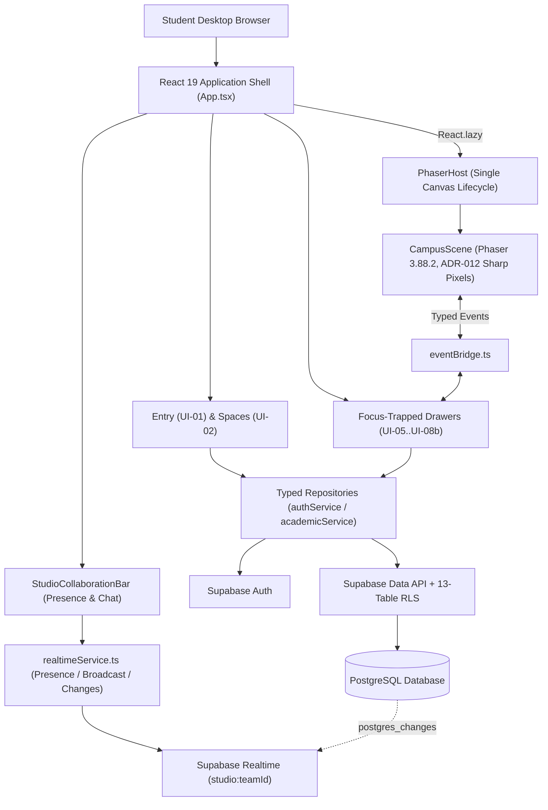

<!-- Cover Page (Excluded from 10-page content limit per STACK 2026 rules) -->

# LearnNexus: A Persistent Virtual Campus for Collaborative Project-Based Learning

**STACK 2026 Semifinal Proposal**  
**Challenge Case:** Case 1: Smarter Campus and Learning  
**Team:** SibukTA  
**Team Members:** Edgi Axel (Team Lead), Jonathan Lukas Wijaya, Deffa Kiane, Khaerul Husnaen  
**Live Prototype:** `[LIVE_VERCEL_URL — UPDATED AFTER DEPLOY]`  
**Source Repository:** [https://github.com/edgiaxel/LearnNexus](https://github.com/edgiaxel/LearnNexus)  
**Submission Date:** November 2026  

> *Formatting Note per STACK 2026 Handbook (`docs/STACK_2026.md`): This cover block, Section 7 (References & Disclosures), and the appended signed Declaration of Originality are excluded from the 10-page A4 content limit. Sections 1 through 6 are structured to fit cleanly within <= 10 A4 content pages at 11-12 pt font, 1.15 line spacing, and 2.5 cm margins.*

---

## 1. Project and Team Identity

**LearnNexus** is a browser-based persistent virtual learning environment connecting academic course spaces with dedicated, database-backed team project studios. Developed by **SibukTA** for **STACK 2026 — Case 1: Smarter Campus and Learning**, LearnNexus replaces fragmented chat threads, temporary meeting links, and disconnected task trackers with a calm, pastel-styled **Cozy Digital Campus**.

| Name | Role on Team | Primary Responsibilities |
|---|---|---|
| **Edgi Axel** | Team Lead | Product scope governance, full-stack architecture, Supabase Postgres/RLS & contract integration |
| **Jonathan Lukas Wijaya** | `[CONFIRM EXACT TEAM ROLE]` | `[CONFIRM CONTRIBUTION DETAILS]` |
| **Deffa Kiane** | `[CONFIRM EXACT TEAM ROLE]` | `[CONFIRM CONTRIBUTION DETAILS]` |
| **Khaerul Husnaen** | `[CONFIRM EXACT TEAM ROLE]` | `[CONFIRM CONTRIBUTION DETAILS]` |

---

## 2. Problem and User Analysis

### 2.1 Problem Context & Academic Evidence

University students completing semester-long group projects regularly split work across incompatible tools: instant messengers for coordination, cloud folders for links, static Learning Management Systems (LMS) for announcements, and external boards for tasks. When students share asynchronous timetables outside scheduled class hours, context is lost across threads and participation becomes uneven.

A systematic literature review of online group projects in higher education by **Donelan and Kear (2024)** identifies four persistent failure modes: **uneven student participation, unclear project guidance, scheduling difficulties across teammates, and strained group relationships** [1]. Generic video-meeting rooms do not retain project state after a call ends, while conventional LMS portals feel passive and disconnected from real-time teamwork.

### 2.2 Intended Users

- **Primary User (`U-01`, University Students):** Students enrolled in project-based courses (teams of 3-10 members) needing one persistent workspace for course alignment, sprint tasks, reference links, team brainstorming, and optional live presence.
- **Secondary User (`U-02`, Lecturers, Roadmap M8/M9):** Course instructors organizing classes, assigning teams, distributing briefs, and reviewing submitted deliverables.

### 2.3 Comparison Against Existing Alternatives

| Dimension | LearnNexus | Spatial Meeting Apps (Gather Town / WorkAdventure) | Conventional LMS (Canvas / Moodle) | Generic PM Boards (Trello / Notion) |
|---|---|---|---|---|
| **Academic Course-to-Team Structure** | Native class -> team -> project relational hierarchy in Postgres | Flat rooms with no native course/team enrollment model | Course/roster structure only; weak project workspace | Ad-hoc pages with no enforced course boundaries |
| **Spatial Navigation & Social Presence** | Crisp 2D pixel-art studio, live avatars, 64px proximity rings, chat bubbles | Strong spatial navigation, but sessions are ephemeral without built-in PM | None (menu-driven lists and forms) | None (document/table lists only) |
| **Asynchronous Persistence** | Core Postgres CRUD (briefs, tasks, links, whiteboard, activity log) survives sessions | Relies on third-party embeds or external links | Static forums/files, poor sprint tracking | Strong async boards, disconnected from campus context |
| **Database-Enforced Isolation** | 13-table Postgres Row Level Security (RLS) isolates courses/teams at DB boundary | Room links or guest passcodes | Role-based inside LMS only | Manual workspace invite sharing |

---

## 3. Proposed Solution

### 3.1 Cozy Digital Campus Experience

LearnNexus pairs a warm, WCAG AA-accessible React application shell (**Cozy Digital Campus**: `#F7F4EC` warm parchment cream, `#FFFFFF` cards, `#4A6B46` sage CTAs, `#30343B` charcoal copy) with a sharp 2D pixel-art workspace. All productivity tools render in accessible HTML drawers anchored beside the mounted canvas, keeping spatial context visible at all times.

### 3.2 Core Student User Journey (`10` Steps)

1. **Enter Campus (`UI-01`):** Authenticate via Supabase credentials or one of three explicitly labeled Demo Mode profiles (`Nadia` Team Lead, `Bima` Student, `Rani` Unassigned Guest).
2. **Select Academic Space (`UI-02`):** View enrolled courses (`IF-4031 Software Engineering Studio`, `IF-3210 Human-Computer Interaction`) or an honest empty state (`Rani`).
3. **Enter 2D Studio (`UI-03` / `UI-04`):** Spawn into the team's pixel-art studio rendered with ADR-012 crisp scaling.
4. **Navigate & Discover Workstations:** Walk via `WASD`/Arrows around furniture collisions; approaching any of the 4 stations highlights `[E] Open ...`.
5. **Collaborate Live in Studio (`M6`):** See active teammates' animated avatars, 64px proximity rings, live roster, persisted `room_messages` chat, and 5-second speech bubbles.
6. **Inspect & Edit Project Overview (`UI-05`):** Read or update title, summary, and objectives, see live `"In studio"` member pills, and review trigger-backed `Recent Activity`.
7. **Manage Sprint Tasks (`UI-06`):** Create, edit, filter, reassign, update status, or delete tasks with resilient `Unsaved change` / `Retry save` / `Revert` handling on failures.
8. **Curate Safe Resource Links (`UI-07`):** Filter (`All`, `Docs`, `Design`, `Tools`, `General`), add, open, and delete verified `http(s)` links.
9. **Brainstorm on Team Whiteboard (`UI-08b`):** Sketch freehand on a 480x260 canvas (4 WCAG colors, 2 stroke widths, Undo/Clear) and post/delete pastel sticky notes.
10. **Leave & Return Durably:** Reload the browser, switch accounts (`Nadia` -> `Bima` -> `Nadia`), or return days later with all project data preserved in Postgres.

### 3.3 Implemented vs Planned Scope (Honest Distinction)

| Scope Category | Status | Features Included |
|---|---|---|
| **Implemented & Tested (Semifinal Build)** | **Complete** | `UI-01` Entry Gateway (Supabase Auth + Demo Mode), `UI-02` Academic Spaces + RLS isolation, `UI-03/04` crisp 2D studio, `UI-05` editable Overview + `activity_logs`, `UI-06` full Task CRUD + resilience, `UI-07` safe Resource CRUD, `UI-08b` Team Whiteboard (sketch + sticky notes), Scoped `M6` Realtime avatars/proximity/chat bubbles, lazy Phaser + vendor bundle splitting |
| **Planned / Deferred (Final Day & Post-Semifinal)** | **Not Implemented** | `UI-08` Lecturer Studio Management (`M8`), Multi-Zone Campus Portals & dynamic `workspace_layouts` editor (`UI-10`/`11`/`12`, `M7`), Supabase Storage binary uploads, Project Timeline & Deliverable grading (`UI-09`, remaining `M9`), self-service signup/SSO/admin (`M10`), WebRTC proximity audio/video |

### 3.4 Visual Prototype Evidence (`docs/evidence/screenshots/`)

| Shot | Screen / Flow | Screenshot Path |
|---|---|---|
| `01` | Entry Gateway (`UI-01`): Demo Mode profiles & Student Sign In | `docs/evidence/screenshots/01-entry-gateway.png` |
| `02`–`08` | Academic Spaces, 2D Cozy Studio, Project Overview, Sprint Tasks CRUD, Resource Library, Team Whiteboard (`UI-08b`), and Studio Chat / Unassigned Empty State | `[SCREENSHOT_02_TO_08_FILENAMES — UPDATED AFTER QA CAPTURE]` |
| `09` | Multi-User Realtime Split Screen (`Nadia` + `Bima` live avatars, proximity ring, chat bubbles & synced workspace) | `docs/evidence/screenshots/09-multiuser-realtime-split.png` |

---

## 4. Technical Design

### 4.1 System Architecture

LearnNexus enforces strict functional separation: React owns accessible productivity UI, Phaser 3 owns only 2D spatial rendering via a typed `eventBridge`, and Supabase Postgres + RLS serves as the authoritative persistence layer regardless of Realtime connectivity.

### 4.2 Technology Stack & Optimization

- **Frontend:** React `19.1`, TypeScript `5.8`, Vite `6.2`, Tailwind CSS v4 (`src/styles/index.css`).
- **2D Engine:** Phaser `3.88.2` lazy-loaded (`React.lazy` + `<Suspense>`) and isolated into `vendor-phaser` alongside `vendor-react` and `vendor-supabase` via Rollup `manualChunks` (`vite.config.ts`). Enforces `pixelArt: true`, `antialias: false`, `roundPixels: true`, `FilterMode.NEAREST`, and integer camera zoom (`2`/`3`).
- **Backend & Security:** Supabase Auth, `@supabase/supabase-js` v2, 13-table PostgreSQL with RLS, `SECURITY DEFINER` membership helpers, column-level write grants, URL regex constraint (`url ~* '^https?://'`), and trigger-backed `activity_logs`.
- **Hosting & CI:** Vercel (`vercel.json` SPA rewrites + security headers) and GitHub Actions (`.github/workflows/ci.yml` running `typecheck`, `test:unit`, `build`).
- **Bundle Metrics:** `[M4_BUNDLE_METRICS — UPDATED AFTER BUILD]`

### 4.3 Relational Data Model (`13` Public Tables)

- **Core Academic & Workspace (`9` M2 tables):** `profiles`, `classes`, `class_members`, `teams`, `team_members`, `projects`, `tasks`, `resources`, `workspace_layouts`.
- **Collaboration & Whiteboard (`4` M6/M9 tables):** `room_messages` (append-only team chat), `whiteboard_notes` (pastel sticky notes), `whiteboard_strokes` (JSON point strokes), `activity_logs` (immutable audit entries generated solely by `log_project_activity()` database triggers).
- **RLS Isolation Guarantee:** Unauthenticated `anon` queries fail with SQLSTATE `42501` (`0` rows). Enrolled members access only their own classes/teams (`Nadia`: 2 classes; `Bima`: 1 class; `Rani`: 0 classes), and cross-team mutations or client `activity_logs` inserts are blocked at the database boundary.

---

## 5. Development Plan

### 5.1 Milestone Progress & Verification Snapshot

| Milestone | Scope | Status | Verification Summary |
|---|---|---|---|
| **M0-M1** | Shared `UI_CONTRACT.md`, Cozy tokens, React + Lazy Phaser 3 ADR-012 shell & `eventBridge` | **Completed** | `8/8` E2E specs + single-canvas 1x/2x sharpness verified |
| **M2-M2.5** | Entry (`UI-01`), Spaces (`UI-02`), 2D studio (`UI-03/04`), live Supabase panels (`UI-05`–`07`), WCAG AA | **Completed** | `14/14` E2E specs + real Supabase Auth/Postgres verified |
| **M3** | Session-expiry guards, `Unsaved change`/`Retry save`/`Revert`, 4-actor RLS, unit suite | **Completed** | `18/18` E2E specs, `11/11` unit tests, `4/4` RLS actors |
| **Scoped M6 + M9** | Multi-user Realtime avatars, proximity rings, room chat bubbles, full Task/Brief/Resource CRUD, `activity_logs`, Whiteboard (`UI-08b`) | **Completed** | `22/22` E2E specs, `17/17` unit tests, `4/4` RLS actors across `13` tables |
| **M4** | Lazy Phaser & vendor chunking, Vercel config, CI, M4 QA audit, screenshots & 1080p takes | **In Progress / Finalizing** | `[M4_FINAL_VERIFICATION — UPDATED AFTER E2E]` |
| **M5** | Live Vercel smoke test, peer usability testing (`5-10` students), Semifinal PDF & <=2m video | **In Progress (Due 30 Nov)** | Tracked via `docs/TEAM_SUBMISSION_CHECKLIST.md` |

### 5.2 Teammate Contributions

| Member | Primary Contributions |
|---|---|
| **Edgi Axel** | Lead architecture, `UI_CONTRACT.md`, Supabase 13-table schema/RLS & triggers, Phaser/React integration, M4 chunking/CI/Vercel |
| **Jonathan Lukas Wijaya** | `[CONFIRM CONTRIBUTION DETAILS]` |
| **Deffa Kiane** | `[CONFIRM CONTRIBUTION DETAILS]` |
| **Khaerul Husnaen** | `[CONFIRM CONTRIBUTION DETAILS]` |

### 5.3 Planned Final Day Build Tasks (`19 December 2026`: 3 Substantive Tasks)

Consistent with `docs/STACK_2026.md` Final Phase guidelines, SibukTA retains three substantive implementation tasks for the Final Day build session (building directly on top of the verified semifinal baseline):

1. **Lecturer Studio Management (`UI-08`) & Role-Scoped RLS Policies (`M8`):** Add Supabase migrations and RLS write policies for `class_members.role = 'lecturer'`, seed a demo lecturer account, and build `UI-08` so instructors can create teams, assign student rosters, and push course announcements/tasks directly into student workspaces.
2. **Multi-Zone Virtual Campus Portals & Configurable Layouts (`UI-10` / `UI-11` / `UI-12`, `M7`):** Connect distinct pixel-art rooms (Main Hall, Classroom Wing, Campus Library, Student Commons) to Team Studio Pods via Phaser doorway `PortalEvent` transitions and dynamically hydrate `workspace_layouts.config_json` room presets from Postgres.
3. **Deliverables Submission & Review Workflow (`UI-09`) with Supabase Storage (`M9`):** Provision team-scoped Supabase Storage buckets (MIME/size checks + RLS policies) and build the `UI-09` Deliverables drawer supporting PDF/artifact uploads, submission status (`draft` / `submitted` / `reviewed`), and lecturer review comments.

---

## 6. Validation and Impact

### 6.1 Engineering Verification & Primary Student Usability Testing

- **Automated Verification:** LearnNexus is validated end-to-end by strict TypeScript (`tsc --noEmit`), Node native unit guards (`npm run test:unit`), live 4-actor 13-table database RLS enforcement (`npm run test:rls`), and Chromium Playwright suites covering multi-context Realtime sync and persistence across reloads (`[M4_FINAL_VERIFICATION — UPDATED AFTER E2E]`).
- **Primary Student Usability Study:**
  `[PENDING REAL STUDENT USABILITY DATA — COLLECT WITH docs/USABILITY_TEST_SHEET.md]`

### 6.2 Expected Impact, Privacy & Sustainability

- **Measurable Student Impact:** Consolidates course context, spatial awareness, sprint tasks, reference links, and shared brainstorming into a single URL, reducing tool-switching friction and making uneven task progress immediately visible across student timetables.
- **Privacy & Data Protection:** Enforces least-privilege access in PostgreSQL RLS rather than client UI hiding; zero `service_role` keys ship to browsers; external links validate `https?://` at both UI and database constraint layers; all demo accounts use fictional non-PII fixtures.
- **Sustainability:** Built on open standards (`Apache 2.0` core), lightweight static Vite/Vercel hosting with lazy-loaded Phaser assets, and an asynchronous-first Postgres architecture that operates sustainably within managed free-tier quotas without requiring constant 24/7 WebSocket occupancy.

---

## 7. References and Declaration

*(Excluded from the 10-page A4 content limit per STACK 2026 Semifinal Proposal Requirements)*

### 7.1 Academic & Technical References

1. Donelan, H., & Kear, K. (2024). Online group projects in higher education: persistent challenges and implications for practice. *Journal of Computing in Higher Education*, 36, 435-468. [https://doi.org/10.1007/s12528-023-09360-7](https://doi.org/10.1007/s12528-023-09360-7)
2. React 19, TypeScript 5.8, Vite 6.2, Tailwind CSS v4, Playwright (MIT / Apache-2.0 open-source dependencies pinned in `package-lock.json`).
3. Phaser 3 (`v3.88.2`, MIT License): [https://docs.phaser.io/api-documentation/3.88.2/class/game](https://docs.phaser.io/api-documentation/3.88.2/class/game)
4. Supabase JS v2 & PostgreSQL Row Level Security Documentation (Apache-2.0 / MIT): [https://supabase.com/docs/guides/database/postgres/row-level-security](https://supabase.com/docs/guides/database/postgres/row-level-security)

### 7.2 Third-Party Visual Assets & Licensing

- **LearnNexus Source Code:** Licensed under **Apache License, Version 2.0** (`LICENSE`).
- **2D Pixel-Art Sprites & Interior Tilesets:** **LimeZu Modern Interiors Free Version** ([https://limezu.itch.io/moderninteriors](https://limezu.itch.io/moderninteriors)), excluded from Apache 2.0 and governed strictly by [`assets/LICENSE.txt`](../assets/LICENSE.txt) (permitted: non-commercial projects and non-commercial sprite editing; prohibited: commercial projects, commercial editing, or reselling sprites).
- **Spatial UI References:** `assets/1.png`, `assets/2.jpg`, and `assets/3.png` through `assets/7.png` (Gather Town / Gather Town 2.0 screenshots) served strictly as layout and UX references during design and are not bundled runtime assets.

### 7.3 Material AI Assistance Disclosure

Per STACK 2026 Technology and AI Usage Rule #4 (`docs/STACK_2026.md`):

- **Runtime AI Statement:** LearnNexus contains **zero runtime AI features** (no LLM integrations, chatbots, or AI agents inside the application).
- **Development AI Assistance:**

| AI Tool | Scope of Assistance | Human Team Verification & Ownership |
|---|---|---|
| Google Antigravity / Gemini coding models (AI coding assistants / multi-worktree agents) | Repository scaffolding, TypeScript refactoring, Supabase SQL & RLS drafting, Playwright E2E test authoring, and documentation structuring | Human team defined the problem, Cozy Digital Campus UX & architecture contracts, reviewed every Postgres RLS policy and diff, ran browser/RLS checks, collected usability testing, and verified final acceptance |

### 7.4 Appendix: Declaration of Originality

**Action before PDF export:** Append the signed official STACK 2026 Declaration of Originality (`https://s.id/DeclarationOfOriginalitySTACK2026`) immediately after this page when compiling the final semifinal proposal PDF.
